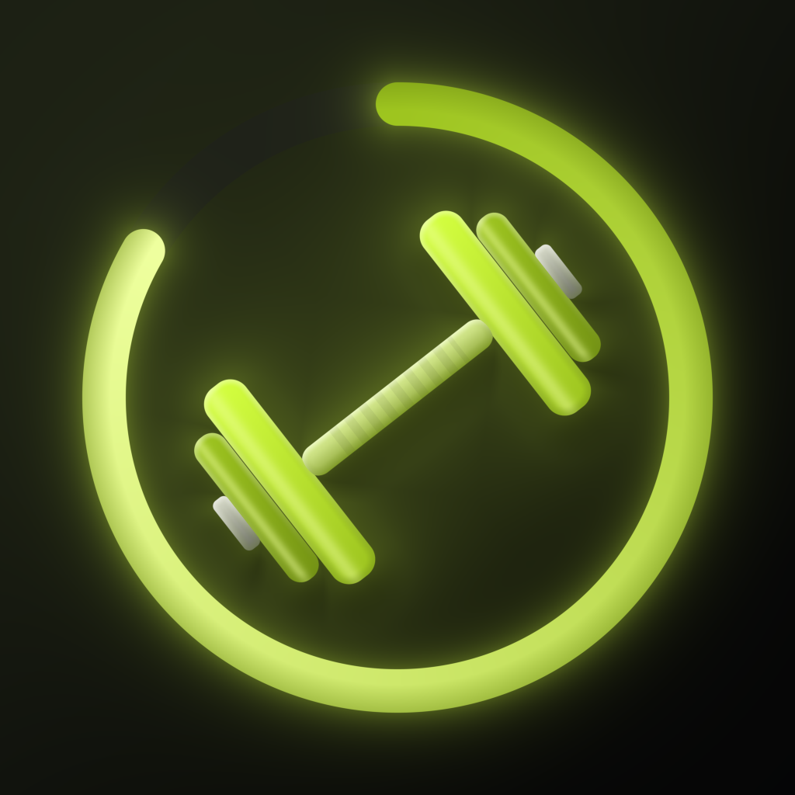

# RepTrack for iOS



A native **SwiftUI** workout and rep tracker for iPhone (iOS 17+). Pick a day, add exercises,
log every set (weight in kg + reps), tick sets off as you finish them and watch your progressive
overload week by week or month by month.

Everything is stored on the phone — no account, no network, no tracking.

## Features

- **Day view** – swipeable week strip with dots on training days, calendar picker, "Today" shortcut.
- **Exercises & sets** – reps stepper (tap ±1, hold ±5), tap to type exact weight/reps, tick sets off,
  swipe a set left to delete it, undo for deletes, rename / collapse / copy to today.
- **Smart pre-fill** – new sets copy the previous set; body-weight moves (pull-ups, dips, push-ups…)
  start at a share of your body weight from your profile.
- **Suggestions** – recent and popular exercises, plus your own "My list".
- **Day summary** – volume, sets done and total reps with a completion bar.
- **Rest timer** – 0:30–3:00, ±15 s, auto-start after ticking a set off.
- **Progress** – this week/month vs the previous one: how many exercises improved (estimated
  one-rep max, or best-set reps for unweighted work), volume / training days / sets / reps changes,
  an 8-week or 6-month volume chart, and a sortable list of every exercise.
- **Excel export** – save the report as an `.xlsx` file to the Files app.

## Project structure

```
project.yml                  XcodeGen recipe that describes the Xcode project
RepTrack/
  App/                       App entry point and the two-screen navigation
  Domain/                    Pure Swift logic: dates, totals, e1RM, progress report, suggestions
  Data/                      SwiftData tables and repositories (all reads/writes go through here)
  Export/                    .xlsx writer (zip + XML) and the Files "save" document
  ViewModels/                @Observable view models and the rest timer (MVVM)
  Views/                     SwiftUI screens: Tracker/, Progress/, shared Components/ and Theme/
  Resources/                 Asset catalog (app icon, accent colour)
RepTrackTests/               XCTest unit tests for the logic, database and view models
tools/generate-app-icon.mjs  Renders the app icon PNG (run with Node.js)
.github/workflows/ios.yml    The CI pipeline
```

**How the pieces talk (MVVM):** a *View* shows data from a *ViewModel* and calls its methods
when you tap something. The ViewModel asks a *Repository* to change the database. After every save
the data store tells the ViewModels to reload, so the screen always shows what is really stored.

There is **no `.xcodeproj` in the repo.** [XcodeGen](https://github.com/yonaskolb/XcodeGen) creates it
from `project.yml` during the build, which keeps the project file readable and free of merge conflicts.

## How CI works

Every push to `main` (or a manual run) starts the **iOS CI** workflow on a GitHub-hosted Mac:

1. Install XcodeGen (cached between runs) and generate `RepTrack.xcodeproj`.
2. Build the app for the **iOS Simulator** (Release, Apple-silicon and Intel) and zip `RepTrack.app`.
3. Upload the zip as the **`RepTrack-simulator`** artifact (kept for 30 days).
4. Run all unit tests on an iPhone simulator. Logs and test results are uploaded as
   `logs-and-test-results`.
5. Optional **Upload to Appetize** job — runs only if the `APPETIZE_API_TOKEN` secret exists.

The repository is public, so the macOS build minutes are free.
See the runs under the **Actions** tab of the repository.

## Try the app in your browser (Appetize.io)

You don't need a Mac or an iPhone — [Appetize.io](https://appetize.io) runs the simulator build in a browser.

### Manual upload

1. Open the repository on GitHub → **Actions** → click the latest green **iOS CI** run.
2. Scroll to **Artifacts** and download **RepTrack-simulator**.
3. GitHub wraps every artifact in a zip, so **unzip the download once**. Inside is
   `RepTrack-simulator.zip` — that file is what Appetize needs (don't unzip it).
4. Go to [appetize.io/upload](https://appetize.io/upload), sign in, choose **iOS**, and upload
   `RepTrack-simulator.zip`.
5. Open the link Appetize gives you and pick an iPhone model. The app starts in the browser.

### Automatic upload after every build (optional)

1. In Appetize, open **Account → API token** and create a token. Copy it.
2. On GitHub, open the repository → **Settings → Secrets and variables → Actions**.
3. Under **Secrets**, click **New repository secret**, name it `APPETIZE_API_TOKEN`, paste the token, save.
4. Run the workflow again (**Actions → iOS CI → Run workflow**). The **Upload to Appetize** job now
   creates an app and prints its link in the run summary.
5. To keep the **same link** for future builds, copy the public key from that link
   (`https://appetize.io/app/<publicKey>`), then go to **Settings → Secrets and variables → Actions →
   Variables**, add a variable named `APPETIZE_PUBLIC_KEY` with that value. Later builds update that app.

## Building on a Mac (optional)

```bash
brew install xcodegen
xcodegen generate
open RepTrack.xcodeproj
```

Run tests from the terminal:

```bash
xcodebuild test -project RepTrack.xcodeproj -scheme RepTrack \
  -destination 'platform=iOS Simulator,name=iPhone 16'
```

## Regenerating the app icon

```bash
node tools/generate-app-icon.mjs RepTrack/Resources/Assets.xcassets/AppIcon.appiconset/AppIcon.png
```
